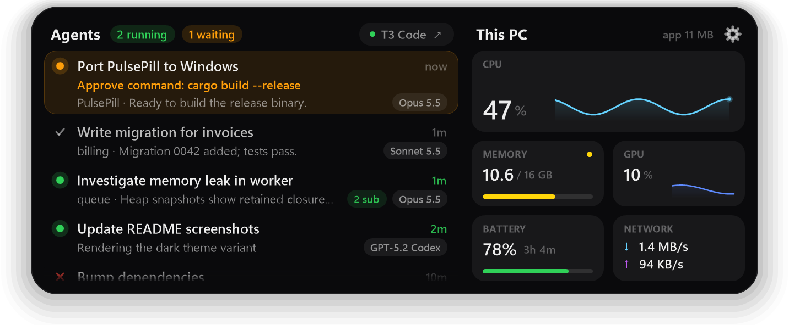

# PulsePill

A Dynamic-Island-style pill for Windows. It shows what your T3 Code agents and your PC are doing,
at a glance. Hover it to expand into two columns.

PulsePill is a Windows port of [NotchPulse](https://github.com/lubluniky/NotchPulse) by lubluniky,
which does the same around the MacBook notch. This is a rewrite rather than a recompile: the
original is a SwiftUI/AppKit app, and PulsePill is a single native Win32 window drawn with GDI+,
written in Rust. The T3 Code status logic and its SQL queries are ported from NotchPulse.



## Features

- **Agents column**: running, waiting-for-input, done and failed T3 Code threads, with the pending
  approval or question, a preview of the last message, the model, and live subagents. Click a
  thread to open it in T3 Code (`t3code://threads/<env>/<thread>`).
- **This PC column**: CPU with a sparkline, GPU load (same counter as Task Manager), memory,
  network throughput, and one tile you choose: battery, disk space, disk activity or uptime.
  By default it shows the battery on laptops and disk space on desktop PCs.
- **Collapsed pill**: waiting/running counters on the left, CPU sparkline and % on the right.
  Low battery takes over the right side.
- **Drag it anywhere**, on any monitor. The position is remembered. In the lower half of a screen
  the island expands upwards. Near a screen edge the expanded panel is kept on screen. Drop it near
  the top center and it snaps back to the default spot.
- **Hide / show**: left-click the tray icon, press **Ctrl+Alt+N**, middle-click the pill, or use
  the menu.
- Steps aside while a full-screen app (game, video, presentation) is in front.
- **Settings menu**: the gear in the top-right corner of the expanded island (right-clicking the
  pill or the tray icon also works): *Hide island*, *Keep expanded*, *Reset position*,
  *Open T3 Code*, *Bottom-left tile*, *Start with Windows*, *Quit*.
- **Read-only, no network, no telemetry.** The T3 database is opened read-only.

## Footprint

The whole app is one ~450 KB `.exe` with no runtime dependencies. Memory is measured on Windows 11
with a 400k-item T3 database, as Task Manager's "Memory" column shows it (private working set):

| Mode       | Memory | CPU idle |
| ---------- | ------ | -------- |
| default    | ~11 MB | ~0%      |
| `--no-gpu` | ~5 MB  | ~0%      |

Most of the 6 MB difference is the Windows performance-counter library (PDH) that the GPU tile
needs. If you don't need the GPU tile, run with `--no-gpu`.

A 10-minute run, kept expanded and redrawing every second against live T3 data, rose from 12.0 to
13.3 MB of private bytes during the first ~4 minutes while the SQLite page cache (capped at 1 MB)
filled, then stayed flat. GDI objects (5) and handles (~148) did not change.

## Build & run

You need a Rust toolchain. Either `x86_64-pc-windows-msvc` or `x86_64-pc-windows-gnu` works, and no
C compiler is needed: SQLite comes from Windows' own `winsqlite3.dll`. Windows 10 or 11.

```sh
cargo build --release
./target/release/pulsepill.exe               # live
./target/release/pulsepill.exe --mock --expanded
./target/release/pulsepill.exe --dump        # print what the pill would show, then exit
```

## Starting, hiding and quitting

PulsePill is a single `.exe` with no installer. Put it anywhere and run it.

- **It doesn't start with Windows by default.** Turn on *Start with Windows* in the settings
  menu. If you move the `.exe` later, the entry follows it on the next launch.
- On first launch a notification explains the controls. The tray icon may land in the hidden
  icons area (`^`) at first. Drag it onto the taskbar to keep it visible.
- **Hide it**: left-click the tray icon, press **Ctrl+Alt+N**, or middle-click the pill. It keeps
  running in the tray. The same actions bring it back.
- **Quit**: open the menu (gear, or right-click the pill or tray icon) and choose *Quit*.
- **Uninstall**: run `pulsepill.exe --uninstall` to remove the autostart entry and settings
  (`HKCU\Software\PulsePill`), then delete the `.exe`.

## Flags

| Flag                                    | Description                                         |
| --------------------------------------- | --------------------------------------------------- |
| `--mock`                                | Built-in sample data instead of live data.          |
| `--mock-scenario=busy\|calm\|idle\|hot` | Pick a sample scenario (implies `--mock`).          |
| `--expanded`                            | Keep the island expanded.                           |
| `--no-gpu`                              | Skip the GPU counter (saves ~6 MB).                 |
| `--hidden`                              | Start hidden (tray icon / Ctrl+Alt+N to show).      |
| `--tile=auto\|battery\|disk\|diskio\|uptime` | Pick the bottom-left tile for this run.      |
| `--uninstall`                           | Remove autostart and settings from the registry.    |
| `--dump`                                | Print T3 threads, query timing and PC vitals, exit. |
| `--render-png=<file>`                   | Draw the expanded pill with sample data to a PNG.   |

## How it works

| Data             | Source                                                                  |
| ---------------- | ----------------------------------------------------------------------- |
| T3 Code threads  | `%USERPROFILE%\.t3\userdata\statev2.sqlite` via `winsqlite3.dll`, read-only |
| T3 liveness      | `pid` in `server-runtime.json`, checked with `OpenProcess`              |
| Change detection | size/mtime of the DB, its WAL and the runtime file, polled once a second; queries run only when they change (or every 15 s) |
| CPU              | `GetSystemTimes`                                                        |
| GPU              | PDH `\GPU Engine(*)\Utilization Percentage`, busiest engine type        |
| Memory           | `GlobalMemoryStatusEx`                                                  |
| Network          | `GetIfTable2`, physical non-filter interfaces only                      |
| Battery          | `GetSystemPowerStatus`                                                  |
| Disk space       | `GetDiskFreeSpaceExW` on the system drive, every 10 s                   |
| Disk activity    | PDH `\PhysicalDisk(_Total)\` idle time and read/write bytes, opened only while that tile is selected (~0.7 MB) |
| Uptime           | `GetTickCount64`                                                        |
| Window           | layered `WS_EX_TOPMOST \| WS_EX_NOACTIVATE` popup drawn with `UpdateLayeredWindow` and per-pixel alpha, so transparent areas pass clicks through |
| Settings         | `HKCU\Software\PulsePill` (position, tile), `HKCU\...\Run` (start with Windows) |

`$T3CODE_HOME` overrides the T3 base directory, as in NotchPulse.

One query differs from NotchPulse: the "secret request" check now looks at active runs first and
then does an indexed lookup, instead of scanning every turn item of every thread. Results are the
same, and on a large database the main query went from ~250 ms to ~37 ms.

## Differences from NotchPulse

- No notch on Windows, so by default the pill floats 6 px below the top edge of the primary
  monitor, and you can drag it elsewhere.
- No SoC temperature: Windows has no reliable unprivileged API for it. A GPU tile takes its place.

## Credits

Design, T3 Code status model and queries: [NotchPulse](https://github.com/lubluniky/NotchPulse)
by lubluniky, MIT License.

## License

[MIT](LICENSE). Includes work from NotchPulse, Copyright (c) 2026 lubluniky.
